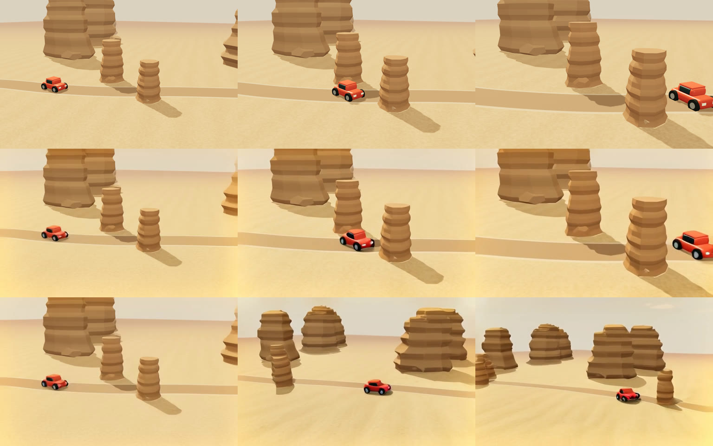

# Toybox Director

**A little stage for big ideas.**

Toybox is an open-source, local-first take on a cinematic AI video studio: instead of describing a shot in a prompt box, you **block it**. Arrange toy props on a 3D stage, pick a camera move, set three keyframes, and render. Your staging and camera move are captured from the 3D world and guide an open-weight LTX video model in your own ComfyUI. Keep every take, then trim your favorites into a film.

Built with React, Three.js, Express, and the official [Comfy SDK](https://www.npmjs.com/package/@comfyorg/sdk) for Comfy's *Open Source Higgsfield* challenge. Open-weight models only; no partner nodes or paid APIs are required.



## Start the studio

Requires Node.js 22.18 or newer. Film export also requires **FFmpeg and FFprobe on PATH**, with H.264 encoding support.

```sh
npm install
npm run build
npm start
```

Open **http://127.0.0.1:3001**. The production studio and its API share this address. Staging, project autosave, look references, and project export/import work without a render engine. A missing build produces instructions to run `npm run build`.

For development, use `npm run dev` and open **http://127.0.0.1:5173**. Stop that command before running `npm start`: both use the API on port 3001.

To preview a built frontend with Vite, keep the API running with `npm run server`, run `npm run preview` in another terminal, and open **http://127.0.0.1:4173**. The preview proxies API requests to port 3001; `npm start` remains the single-process production command. A custom `PORT` in `.env` changes the production address; the development and preview proxies expect port 3001.

**Before switching addresses, export your projects.** Browser projects belong to their exact origin: `127.0.0.1:5173`, `127.0.0.1:3001`, and `localhost:3001` have separate project libraries. Export each `.toybox.json` backup from the old address, then import it at the new one. The server's render library remains available from either studio address when they use the same Toybox data directory.

## Render locally

```sh
npm run setup:local
# Install the models listed in docs/LOCAL-RUNTIME.md.
npm run setup:local -- --start
# In a second terminal, after building the studio:
npm start
```

Setup installs isolated ComfyUI and the official API v2 proxy under the ignored `.toybox/runtime` directory. It creates `.env` for localhost and configures the bundled workflow. Model weights are a separate ~16 GB download; source URLs, exact hashes, and licenses are recorded in [the runtime guide](docs/LOCAL-RUNTIME.md). FFmpeg and FFprobe for film export are separate system prerequisites; the setup helper does not install them.

`npm run setup:local -- --status` checks whether the engine is running. The full local pipeline has been verified on macOS with Apple Silicon (M5 Max, 128 GB, MPS); other GPUs and operating systems have not been verified yet.

- Production studio and Toybox API: `http://127.0.0.1:3001`
- Development studio: `http://127.0.0.1:5173`
- ComfyUI: `http://127.0.0.1:8188`
- Comfy API proxy: `http://127.0.0.1:8189`

The API is bound to localhost. This is a single-user local app, not a multi-tenant public service.

## What you can do in 0.2

- Move, rotate, recolor, resize, and cast a car, mugs, blocks, marbles, and trees in a real 3D stage.
- Start from three authored **Story sparks**: a commuting city, a doorway looking for a home, or a lunar parade for a tree. Each opens an editable three-scene film and preserves your earlier project.
- Try **Director’s dares** that move the scenery, reverse the scale hierarchy, or close a stage loop. Each creates a separate take with the original intact.
- Set beginning, middle, and ending positions and pick a camera move; play and scrub the staging animation. All three keyframes guide the generated video.
- Transform the same layout into a live canyon, lunar outpost, or night city, or upload a real photo for a keyframe.
- Save multiple projects in IndexedDB, switch between them, undo/redo edits, and export/import editable `.toybox.json` backups.
- Generate real video through the bundled open-weight LTX 2B workflow, or import and map another Comfy API workflow.
- Render every scene in a project as a batch, with up to 12 active render jobs. Stop adding unsubmitted shots, cancel individual active jobs, or retry failed and canceled renders.
- Browse a durable render library across browser and API restarts; download media or explicitly delete a take and its files.
- Add completed videos to a film, reorder and trim up to 24 clips, and export a silent 24 fps H.264 MP4 up to five minutes long. Two film exports can run concurrently.
- Export shot direction and source frames for use elsewhere.

Keyboard: **Space** plays the stage; **1 / 2 / 3** selects a keyframe; **Cmd/Ctrl+Z** undoes; **Cmd/Ctrl+Shift+Z** redoes; **Cmd/Ctrl+S** exports the project. Numeric prop controls provide an alternative to dragging.

## What generation does today

**Your staging drives the video.** The bundled workflow captures all three keyframes from the 3D world, including the shot's camera move, and gives them to LTX as guide frames at the start, middle, and end of the clip (core `LTXVAddGuide` nodes). The prompt adds the world, cast, camera move, and a plain-language description of how each prop travels.

*Above: the three staged keyframes with a push-in. Middle: the guided LTX render at 0, 3, and 6 seconds. Bottom: the same seed and prompt with only the first frame; the model invents its own path and scenery.*

Guides steer the model strongly but are not pixel-exact; LTX fills the motion between them. If keyframe 1 is an uploaded photo, later keyframes without their own photo are left out so the stage world never fights your photo. Draft output is 512×320 at 24 fps. Duration maps to the model's valid `8n+1` frame counts. Camera moves: locked off, push in, pull out, orbit left or right, crane up or down.

The images in `public/images` are illustrative concepts, not renders made by this app. Their prompts and provenance are included beside them. Completed videos appear in the render library only after the engine produces and Toybox downloads them.

Film export joins existing videos; it does not run the generation model again. It normalizes the edit to 24 fps and the first clip's aspect ratio, capped at 1920×1080, and omits audio. Different aspect ratios receive black padding.

## Saves, recovery, and sharing

| Data | Location and behavior |
| --- | --- |
| Editable projects and film edits | Browser IndexedDB, autosaved separately for each project and browser origin. The old single-project localStorage save is migrated on the same origin. |
| Workflow and render records | `.toybox/workflow.json` and `.toybox/jobs/`. Records preserve metadata, original inputs, the workflow, and upstream job identity. |
| Rendered videos and movie exports | `.toybox/outputs/`. They survive restarts and are removed only by explicit deletion. Older output folders are recovered into the library, with missing video duration metadata backfilled. |
| ComfyUI, models, and proxy state | `.toybox/runtime/`, ignored by Git. |

While the API runs, background polling saves finished media even if the browser closes. After an API restart, Toybox recovers accepted Comfy jobs by their upstream IDs. If Comfy has expired or lost a job, the library reports that and keeps its saved inputs for an explicit retry. An interrupted film export can restart from its source clips.

Project JSON includes props, poses, direction, uploaded frame images, and film edit references. **Generated media is not embedded.** Film references point to this machine's render library and will not resolve on another machine without those renders. Share downloaded MP4 files separately, and export project backups before clearing browser data or changing the studio address.

## How it works

```text
React studio → stage frame + direction → local Express API
            → official @comfyorg/sdk → official API v2 proxy
            → ComfyUI workflow → local GPU → durable MP4 library
Completed clips → trim and order → local FFmpeg → film MP4
```

Credentials stay on the server. Comfy Cloud and managed Comfy deployments are supported through environment configuration; their account usage and costs apply. See [COMFY.md](docs/COMFY.md) and [workflow documentation](workflows/README.md).

## Development and verification

```sh
npm run dev
npm test
npm run build
```

The current verification pass has **94 passing tests**, covering keyframe guidance and camera moves, authored story continuity, creative scene transformations, project persistence and migration, malformed imports, film edit validation, workflow bindings, SDK submission and recovery, cancellation, retries, real video assembly, and production file boundaries. Browser checks include desktop and mobile creation, local generation, playback, and MP4 downloads. See [VERIFICATION.md](docs/VERIFICATION.md) for the evidence, [CREATIVE-DIRECTION.md](docs/CREATIVE-DIRECTION.md) for the authoring standard, and the runtime guide for model details. Generation quality and timing depend on hardware, models, and settings.

## License and credits

App code: [MIT](LICENSE). ComfyUI and model files retain their own licenses. LTX model weights use the LTXV Open Weights 0.X license, not this app's MIT license. Manrope uses the SIL Open Font License, included in `public/fonts/OFL.txt`. Interface icons are from Lucide (ISC).
